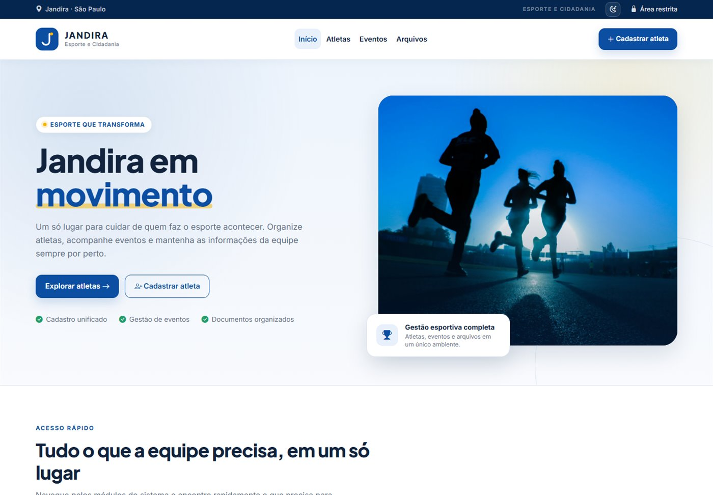
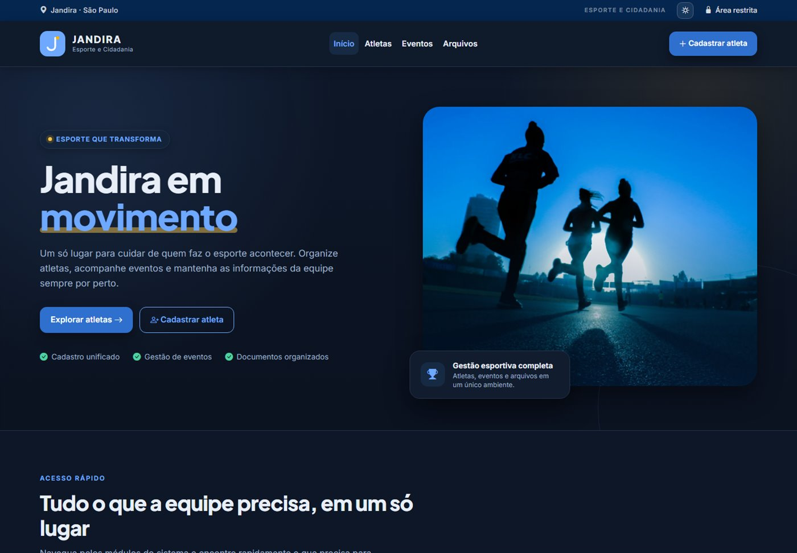
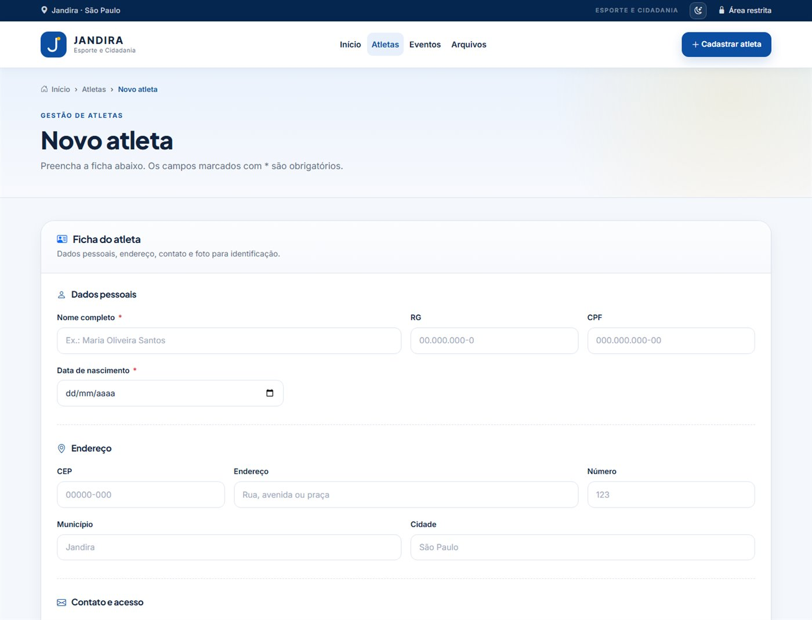
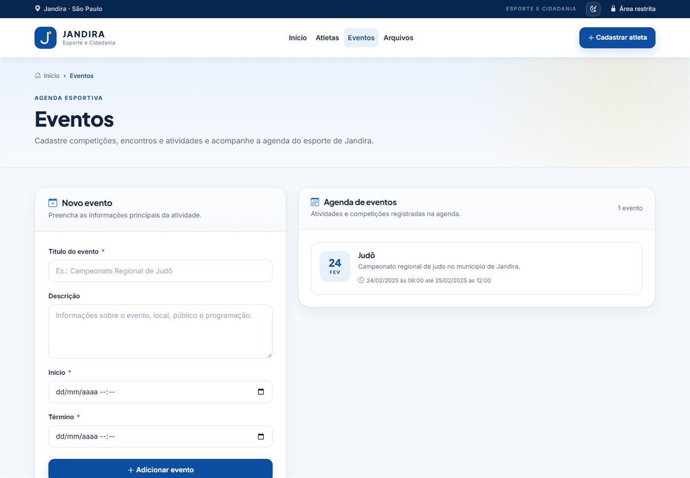
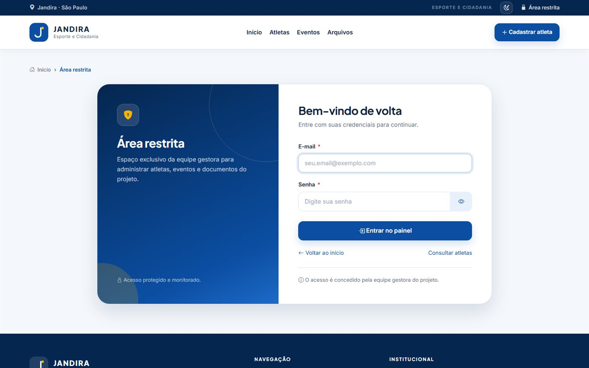
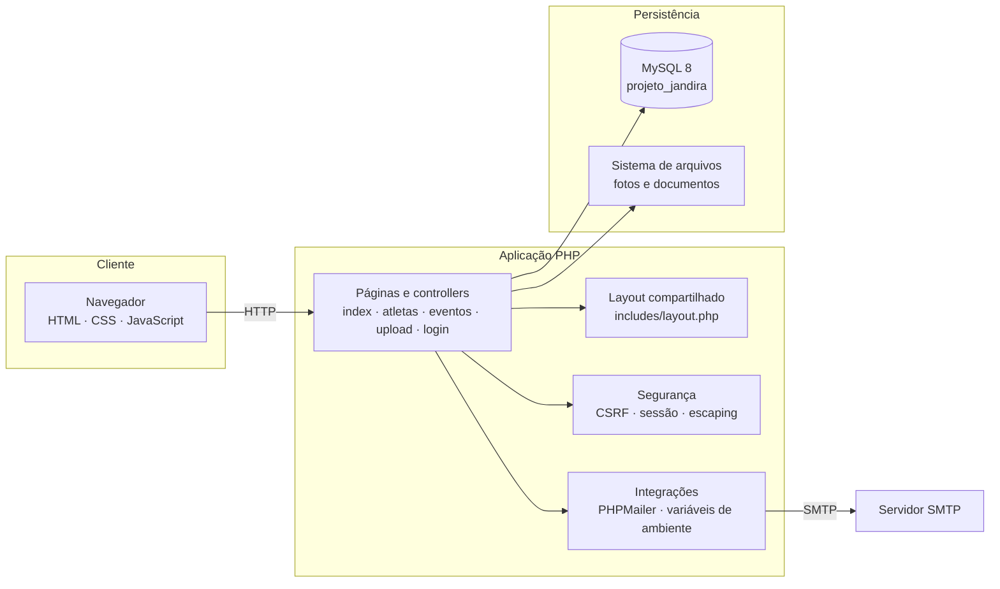
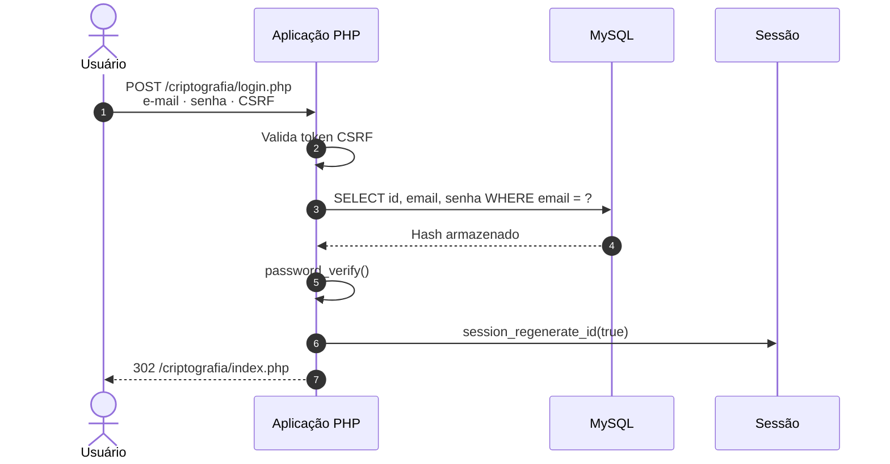
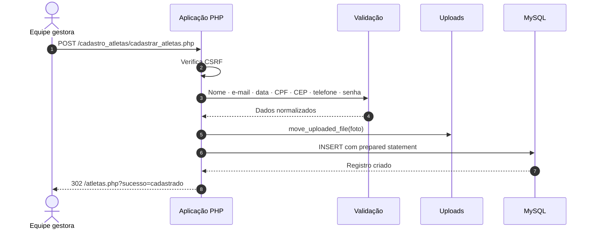
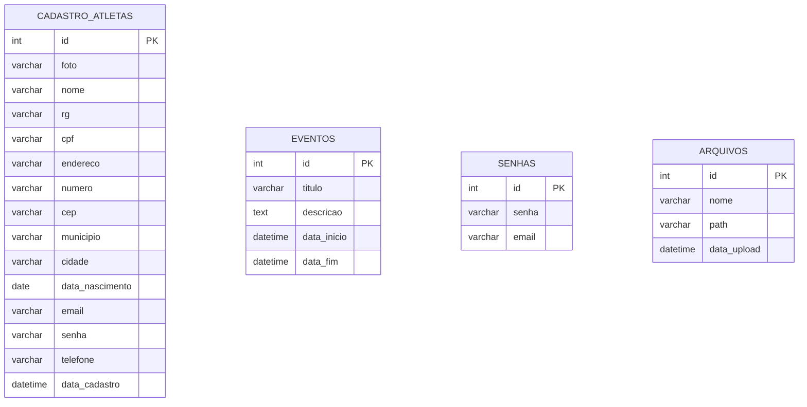

<div align="center">

# Projeto Jandira

### Plataforma de Gestão Esportiva

Uma aplicação web para centralizar atletas, eventos, documentos e acessos da equipe gestora do esporte municipal — com identidade visual institucional, tema claro/escuro e uma base técnica preparada para evoluir.

<br/>


<br/>


</div>

---

## 📖 Visão geral

O **Projeto Jandira** nasceu como uma aplicação de gestão esportiva para o município de Jandira, em São Paulo. A proposta é substituir controles dispersos — planilhas, documentos soltos e formulários isolados — por um ambiente único, com navegação clara, linguagem simples e uma experiência consistente em qualquer dispositivo.

Mais do que um conjunto de cadastros, o projeto foi construído como uma peça de portfólio de nível profissional: cada tela, componente e decisão técnica foi pensada para demonstrar domínio de **arquitetura web**, **experiência do usuário**, **segurança** e **organização de código**.

### Problema que resolve

| Antes | Depois |
| --- | --- |
| Informações de atletas espalhadas em arquivos locais | Cadastro centralizado com busca instantânea |
| Agenda de eventos em anotações ou planilhas | Agenda esportiva com período e descrição |
| Documentos e imagens sem padrão de armazenamento | Galeria organizada com upload e exclusão |
| Acessos administrativos sem controle claro | Área restrita com autenticação e gestão de usuários |
| Interface fragmentada entre telas | Layout compartilhado, breadcrumbs e navegação consistente |

### Para quem foi pensado

- **Secretaria de Esporte e Lazer** — acompanhamento dos atletas e da agenda municipal.
- **Equipe gestora** — manutenção dos cadastros, documentos e acessos administrativos.
- **Comunidade** — consulta pública de atletas, eventos e materiais do projeto.
- **Avaliadores técnicos** — leitura do código, da arquitetura e das decisões de produto.

---

## 🖼️ Interface

Capturas reais da aplicação, em resolução desktop, com os dois temas disponíveis.

<table>
  <tr>
    <td width="50%" align="center">
      
      <br/>
      <sub><strong>Tema claro</strong> — identidade institucional de Jandira</sub>
    </td>
    <td width="50%" align="center">
      
      <br/>
      <sub><strong>Tema escuro</strong> — mesma identidade, com contraste ajustado</sub>
    </td>
  </tr>
</table>

<br/>

<table>
  <tr>
    <td width="33.33%" align="center">
      
      <br/>
      <sub><strong>Cadastro de atleta</strong> — formulário em seções</sub>
    </td>
    <td width="33.33%" align="center">
      
      <br/>
      <sub><strong>Eventos</strong> — criação e agenda</sub>
    </td>
    <td width="33.33%" align="center">
      
      <br/>
      <sub><strong>Área restrita</strong> — acesso da equipe gestora</sub>
    </td>
  </tr>
</table>

---

## 🚀 Funcionalidades

### 🏠 Página inicial

- Hero institucional com chamada para o esporte e a cidadania.
- Acesso rápido aos módulos de **Atletas**, **Eventos**, **Arquivos** e **Área restrita**.
- Blocos de benefícios: organização, agilidade e confiança.
- Chamada final para cadastro de novos atletas.
- Conteúdo público, sem exposição de detalhes técnicos, versões ou credenciais.

### 🧑‍🤝‍🧑 Atletas

- Listagem com **busca instantânea** por nome, CPF, e-mail, cidade ou telefone.
- Avatar com foto do atleta ou iniciais geradas automaticamente.
- Cadastro completo: dados pessoais, endereço, contato, senha de acesso e foto.
- Edição de todos os campos, com troca opcional de foto.
- Exclusão com tela de confirmação e resumo do registro.
- Validação de nome, e-mail, data, CPF, CEP, telefone e senha.
- Máscaras de CPF, CEP e telefone.
- Pré-visualização da foto antes do envio.
- Preservação da senha atual quando o campo de nova senha fica em branco.

### 📅 Eventos

- Cadastro de eventos com título, descrição, início e término.
- Validação de período: o término precisa ser posterior ao início.
- Agenda com cartões de data, descrição e período formatado.
- Ordenação dos eventos mais recentes para os mais antigos.
- Estado vazio com orientação para o primeiro cadastro.

### 📂 Arquivos

- Upload múltiplo de imagens em uma única operação.
- Validação de formato (JPG, PNG, GIF, WEBP) e tamanho (até 2 MB por arquivo).
- Galeria com miniaturas, nome original e data de envio.
- Abertura do arquivo em nova aba.
- Exclusão individual com confirmação.
- Mensagens de retorno para sucessos, falhas parciais e ausência de seleção.

### 🔐 Área restrita

- Login com e-mail e senha.
- Senhas armazenadas com `password_hash` e verificadas com `password_verify`.
- Regeneração do ID de sessão após autenticação.
- Painel administrativo com atalhos para os módulos.
- Cadastro de novos acessos com confirmação de senha.
- Listagem de usuários autorizados.
- Logout seguro via POST com token CSRF.

### ✉️ Módulo de e-mail

- Teste de envio SMTP com PHPMailer.
- Credenciais carregadas de variáveis de ambiente.
- Disparo somente após envio do formulário — abrir a página não envia e-mail.
- Feedback claro quando a configuração ainda não foi preenchida.
- Nenhuma credencial é exibida na interface.

### 🌗 Tema claro e escuro

- Alternância pelo botão no topo da página.
- Preferência salva no `localStorage` do navegador.
- Respeito ao tema do sistema operacional quando não há preferência salva.
- Tokens de cor específicos para cada tema.
- Ajuste de contraste em cards, tabelas, formulários, alertas e estados de foco.

### 🧭 Navegação e feedback

- Cabeçalho e rodapé compartilhados em todas as páginas.
- Menu principal com indicação da página ativa.
- Breadcrumbs em todas as telas internas, com retorno para o início.
- Skip link para acesso rápido ao conteúdo.
- Alertas de sucesso, erro, aviso e informação.
- Estados vazios com orientação para a próxima ação.
- Confirmação antes de ações destrutivas.
- Botão de mostrar/ocultar senha.

---

## 🧭 Utilização e usabilidade

### Fluxo de navegação

1. A **página inicial** apresenta os módulos e os caminhos principais.
2. **Atletas** concentra a consulta, o cadastro, a edição e a exclusão.
3. **Eventos** permite criar atividades e acompanhar a agenda.
4. **Arquivos** organiza fotos e materiais de apoio.
5. **Área restrita** dá acesso ao painel da equipe gestora.
6. O **tema** pode ser alternado a qualquer momento, sem perder a página atual.

### Decisões de usabilidade

| Princípio | Como aparece na aplicação |
| --- | --- |
| **Consistência** | Mesmo header, footer, botões, cards e padrões de formulário em todas as telas |
| **Orientação** | Breadcrumbs, títulos com contexto e menu com estado ativo |
| **Prevenção de erros** | Validação no servidor, máscaras, limites de tamanho e confirmação de exclusão |
| **Feedback** | Alertas, mensagens de sucesso, estados vazios e retorno visual em ações |
| **Eficiência** | Busca instantânea, atalhos no painel e formulários organizados em seções |
| **Acessibilidade** | Skip link, labels associados, `aria-label`, foco visível e contraste |
| **Responsividade** | Grid fluido, menu colapsável, tabelas com rolagem e formulários empilhados |
| **Continuidade** | Tema persistente e navegação previsível entre módulos |

### Acessibilidade

- Estrutura semântica com `header`, `nav`, `main`, `section`, `article` e `footer`.
- Link “Pular para o conteúdo” como primeiro elemento focável.
- Labels explícitos em todos os campos.
- `aria-label` em botões de ícone, como editar, excluir, abrir arquivo e alternar tema.
- `aria-current="page"` no item ativo da navegação.
- `aria-pressed` no botão de tema.
- Mensagens de alerta com `role="alert"`.
- Foco visível em botões, links e campos.
- Respeito a `prefers-reduced-motion` para reduzir animações.

### Responsividade

- Layout desktop com grid de até quatro colunas nos acessos rápidos.
- Menu principal colapsável em telas menores.
- Formulários que passam de múltiplas colunas para uma coluna.
- Tabelas com rolagem horizontal em dispositivos estreitos.
- Botões de ação com largura total em telas muito pequenas.
- Imagens com `max-width: 100%` e miniaturas com carregamento tardio.

### Performance

- Sem framework de front-end ou etapa de build.
- CSS organizado com variáveis e componentes reutilizáveis.
- JavaScript leve, sem dependências além do Bootstrap.
- Busca feita no cliente sobre linhas já renderizadas.
- Imagens da galeria com `loading="lazy"`.
- Conexões de banco com MySQLi e prepared statements.
- Redirecionamento após POST (padrão PRG) para evitar reenvio de formulários.

---

## 🏗️ Arquitetura

A aplicação segue uma arquitetura **monolítica server-side**, com PHP renderizando HTML no servidor e pequenas camadas de interação no navegador. Essa escolha mantém o projeto simples de entender, rápido de executar e fácil de evoluir sem introduzir complexidade desnecessária.

### Visão geral



### Camadas

| Camada | Responsabilidade | Principais arquivos |
| --- | --- | --- |
| **Apresentação** | HTML semântico, layout, componentes e temas | `includes/layout.php`, `assets/css/site.css`, `assets/js/site.js` |
| **Aplicação** | Fluxos de página, validação, mensagens e redirecionamentos | `index.php`, `cadastro_atletas/*.php`, `criptografia/*.php`, `upload/index.php` |
| **Persistência** | Conexão, consultas e operações CRUD | `cadastro_atletas/conexao.php`, `criptografia/conexao.php`, `upload/conexao.php` |
| **Integrações** | Envio de e-mail e leitura de ambiente | `email/enviar.php`, `includes/env.php` |
| **Segurança** | CSRF, sessão, escaping, hash e validação de upload | `includes/layout.php`, páginas de formulário |

### Fluxo de uma requisição

1. O navegador solicita uma página PHP.
2. `includes/layout.php` inicia a sessão, carrega o `.env`, define helpers e prepara o layout.
3. A página consulta o MySQL com prepared statements.
4. Em requisições POST, o token CSRF é validado antes de qualquer alteração.
5. Os dados são validados e normalizados no servidor.
6. A operação é executada e o usuário é redirecionado com uma mensagem de retorno.
7. O layout renderiza header, conteúdo, footer e scripts compartilhados.

### Fluxo de autenticação



### Fluxo de cadastro de atleta



### Estrutura de diretórios

```text
projeto_jandira/
├── assets/
│   ├── css/
│   │   └── site.css              # design system, componentes e temas
│   ├── img/                      # imagens institucionais e capturas
│   └── js/
│       └── site.js               # tema, busca, máscaras, preview e confirmações
├── cadastro_atletas/
│   ├── conexao.php               # conexão e helpers de formatação
│   ├── atletas.php               # listagem e busca
│   ├── cadastrar_atletas.php     # cadastro com upload
│   ├── editar_atletas.php        # edição e troca de foto
│   ├── deletar_atletas.php       # confirmação de exclusão
│   ├── adicionar_eventos.php     # cadastro e agenda de eventos
│   ├── cadastro_atletas.sql      # estrutura da tabela de atletas
│   └── eventos.sql               # estrutura da tabela de eventos
├── criptografia/
│   ├── conexao.php               # conexão da área restrita
│   ├── login.php                 # autenticação
│   ├── logout.php                # encerramento seguro da sessão
│   ├── index.php                 # painel e gestão de acessos
│   └── senhas.sql                # estrutura da tabela de usuários
├── email/
│   ├── enviar.php                # teste SMTP com PHPMailer
│   ├── composer.json             # dependências do módulo
│   ├── composer.lock             # versões travadas das dependências
│   └── vendor/                   # PHPMailer instalado
├── includes/
│   ├── layout.php                # header, footer, helpers e CSRF
│   └── env.php                   # carregamento de variáveis de ambiente
├── upload/
│   ├── index.php                 # upload e galeria
│   ├── conexao.php               # conexão do módulo
│   └── upload.sql                # estrutura da tabela de arquivos
├── .env.example                  # modelo de configuração SMTP
├── .gitignore                    # proteção de credenciais e temporários
├── index.php                     # página inicial
├── AMBIENTE-LOCAL.md             # documentação do ambiente de desenvolvimento
├── LICENSE                       # licença MIT
└── README.md
```

---

## 🧰 Stack tecnológico

| Tecnologia | Versão | Papel no projeto |
| --- | --- | --- |
|  | 8.4 | Backend, renderização server-side, sessão e regras de negócio |
|  | 8.0 | Persistência de atletas, eventos, usuários e arquivos |
|  | Nativo | Conexão e prepared statements |
|  | 5.3.3 | Grid responsivo, componentes e acessibilidade base |
|  | 1.11.3 | Iconografia da interface |
|  | 5 | Estrutura semântica das páginas |
|  | 3 | Design system, temas e responsividade |
|  | ES6+ | Tema, busca, máscaras, preview, confirmações e senha |
|  | 6.9.3 | Envio de e-mail via SMTP |
|  | 2.x | Gerenciamento da dependência de e-mail |
|  | — | Tipografia da interface |
|  | — | Versionamento |
|  | — | Hospedagem do repositório |

### O que não foi usado — e por quê

- **Framework PHP completo:** o projeto prioriza clareza didática e controle explícito do fluxo.
- **Framework SPA:** a aplicação é server-rendered; não há necessidade de um bundle JavaScript.
- **ORM:** as consultas são poucas e explícitas, com prepared statements.
- **Etapa de build:** o CSS e o JavaScript são servidos diretamente, sem transpilação.

---

## 🎨 Design system

A identidade visual foi inspirada no portal oficial da Prefeitura de Jandira: azul institucional, branco, amarelo de destaque e verde para estados positivos. O sistema usa **CSS Custom Properties** para permitir a troca de tema sem duplicar componentes.

### Paleta

| Token | Tema claro | Tema escuro | Uso |
| --- | --- | --- | --- |
| `--brand` | `#0b4ea2` | `#6ea8ff` | Cor principal, links e ações |
| `--brand-dark` | `#07356f` | `#9cc4ff` | Hover e estados ativos |
| `--brand-deep` | `#05264f` | `#05264f` | Topbar, footer e fundos institucionais |
| `--brand-soft` | `#e8f0fb` | `#172a44` | Fundos suaves e ícones |
| `--accent` | `#f4b400` | `#f4c14d` | Destaques e chamadas |
| `--green` | `#1f9d6a` | `#4fd1a1` | Confirmações e benefícios |
| `--ink` | `#12233d` | `#e8eef7` | Texto principal |
| `--muted` | `#5d6f88` | `#9fb0c7` | Texto secundário |
| `--line` | `#dce4ef` | `#24344b` | Bordas e divisores |
| `--surface` | `#f4f7fb` | `#0b1220` | Fundo da página |
| `--white` | `#ffffff` | `#111c2e` | Superfícies de cards |

### Tipografia

- **Plus Jakarta Sans** — títulos, números e elementos de destaque.
- **Inter** — corpo de texto, formulários, tabelas e navegação.
- Escala fluida com `clamp()` para títulos responsivos.
- Peso e espaçamento consistentes entre páginas públicas e administrativas.

### Componentes

- Botões primário, secundário, suave, destaque e contorno.
- Cards de acesso, cards de recurso e cards de arquivo.
- Header institucional com topbar, marca, menu e CTA.
- Footer com navegação, informações institucionais e créditos.
- Breadcrumbs, títulos de página e ações contextuais.
- Tabelas modernas com cabeçalho, busca e contagem de resultados.
- Formulários em seções, com labels, ajuda, validação e ações.
- Upload com área de arraste visual, preview e galeria.
- Alertas, estados vazios, badges e confirmações.
- Tema claro/escuro com transição de cores.

---

## 🗄️ Banco de dados

O banco `projeto_jandira` é composto por quatro tabelas independentes. Não há chaves estrangeiras: cada módulo evolui de forma autônoma.



### Tabelas

| Tabela | Conteúdo | Observações |
| --- | --- | --- |
| `cadastro_atletas` | Dados pessoais, endereço, contato, senha e foto | A senha é armazenada com hash |
| `eventos` | Título, descrição, início e término | O período é validado na aplicação |
| `senhas` | E-mail e hash de senha da equipe gestora | Acesso ao painel administrativo |
| `arquivos` | Nome original, caminho e data de upload | O arquivo físico fica em `upload/arquivos/` |

---

## 🔐 Segurança

### Medidas implementadas

| Proteção | Implementação |
| --- | --- |
| **CSRF** | Token de 256 bits por sessão, campo oculto nos formulários e validação antes de qualquer POST |
| **Falha de CSRF** | Página amigável com HTTP 419 e orientação para recarregar |
| **SQL Injection** | Prepared statements em todas as consultas com entrada do usuário |
| **XSS** | Escaping centralizado com `htmlspecialchars` via helper `e()` |
| **Senhas** | `password_hash` com `PASSWORD_DEFAULT` e `password_verify` |
| **Fixação de sessão** | `session_regenerate_id(true)` após login bem-sucedido |
| **Logout** | Somente via POST com token CSRF e destruição completa da sessão |
| **Upload** | Validação de extensão, tamanho, nome aleatório e `move_uploaded_file` |
| **Segredos** | Credenciais SMTP em `.env`, com `.env.example` versionado e `.env` ignorado |
| **Erros** | Mensagens genéricas para o usuário, sem exposição de stack trace ou credenciais |

### Evoluções recomendadas para produção

- HTTPS obrigatório e cookies de sessão com `Secure`, `HttpOnly` e `SameSite`.
- Política de Content Security Policy (CSP) e headers de segurança.
- Rate limiting em login, upload e formulários públicos.
- Autenticação em dois fatores para a equipe gestora.
- Controle de permissões por papel (RBAC) e trilha de auditoria.
- Validação de tipo real de arquivo no servidor, além da extensão.
- Rotação de credenciais e uso de senha de aplicativo no SMTP.
- Backup automatizado do banco e dos arquivos enviados.
- Testes automatizados e pipeline de integração contínua.

---

## ✅ Qualidade e validação

O projeto foi validado em fluxos reais, com foco em consistência visual, integridade dos dados e comportamento seguro.

| Área | Validação realizada |
| --- | --- |
| **Sintaxe PHP** | Lint em todos os arquivos do projeto |
| **JavaScript** | Verificação de sintaxe com Node.js |
| **Dependências** | `composer validate --strict` no módulo de e-mail |
| **Navegação** | Home, atletas, cadastro, edição, exclusão, eventos, login e upload |
| **Autenticação** | Login, painel, logout e cadastro de novo acesso |
| **CSRF** | POST sem token retorna HTTP 419; POST com token executa a ação |
| **Eventos** | Criação, listagem e validação de período |
| **Atletas** | Edição com preservação de senha e atualização de dados |
| **Uploads** | Envio, exibição, exclusão e limpeza do arquivo físico |
| **Tema** | Alternância, persistência e preferência do sistema |
| **Console** | Páginas principais sem erros de JavaScript |
| **Responsividade** | Menu, formulários, tabelas e botões em breakpoints menores |

---

## 🗺️ Roadmap

### Concluído

- [x] Identidade visual institucional e layout compartilhado.
- [x] Navegação consistente com breadcrumbs e retorno ao início.
- [x] CRUD de atletas com busca, foto e validações.
- [x] Agenda de eventos com validação de período.
- [x] Upload e galeria de arquivos.
- [x] Área restrita com login e gestão de acessos.
- [x] Tema claro/escuro com persistência.
- [x] Proteção CSRF nos formulários.
- [x] Credenciais SMTP em variáveis de ambiente.
- [x] README de portfólio e documentação do ambiente.

### Próximos passos

- [ ] Controle de permissões por papel (administrador, gestor, consulta).
- [ ] Trilha de auditoria das ações administrativas.
- [ ] Paginação e ordenação configurável nas listagens.
- [ ] Dashboard com indicadores de atletas, eventos e arquivos.
- [ ] Exportação de relatórios em CSV e PDF.
- [ ] Inscrição de atletas em eventos.
- [ ] Fila de envio de e-mails e templates institucionais.
- [ ] Testes automatizados com PHPUnit e testes de interface.
- [ ] Pipeline de CI/CD e análise estática.
- [ ] Armazenamento de arquivos em nuvem.
- [ ] Observabilidade, logs estruturados e monitoramento.
- [ ] Adequação à LGPD e política de privacidade.

---

## 📄 Licença

Este projeto está sob a licença **MIT**. Consulte o arquivo [LICENSE](LICENSE) para mais detalhes.

---

## 👥 Contribuidores e autores

<table>
  <tr>
    <td width="50%" align="center" valign="top">
      
      <h3>Julio Abreu</h3>
      <p><strong>Desenvolvedor Full Stack &amp; Cientista da Computação</strong></p>
      <p>
        <a href="mailto:canaldev33@gmail.com">canaldev33@gmail.com</a>
      </p>
      <p>
        <strong>Foco de atuação:</strong><br/>
        Desenvolvimento de aplicações que resolvem problemas reais, aplicações web de alta performance,
        arquitetura em nuvem e soluções em geral.
      </p>
    </td>
    <td width="50%" align="center" valign="top">
      
      <h3>Samuel Abreu</h3>
      <p><strong>Desenvolvedor de Software &amp; Cientista de Dados</strong></p>
      <p>
        <a href="mailto:samuel.abreux@gmail.com">samuel.abreux@gmail.com</a>
      </p>
      <p>
        <strong>Foco de atuação:</strong><br/>
        Engenharia de dados, aplicações web de alta performance, arquitetura em nuvem e soluções
        para o setor público.
      </p>
    </td>
  </tr>
</table>

<div align="center">

<sub>
Projeto Jandira · Plataforma de Gestão Esportiva<br/>
Desenvolvido com dedicação para demonstrar boas práticas de engenharia, produto e experiência do usuário.
</sub>

</div>
